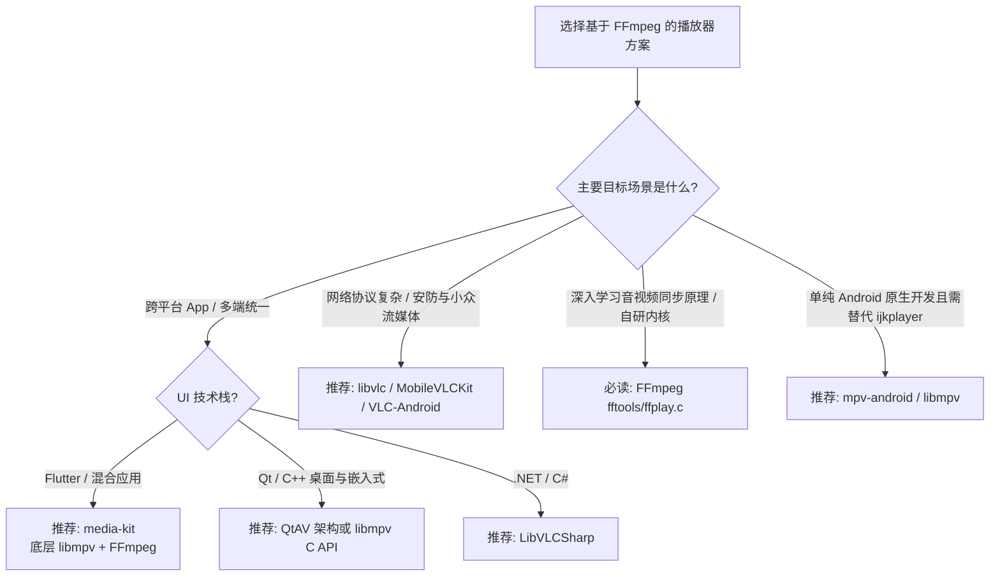

# 基于 FFmpeg 的主流播放器与跨平台选型指南

在音视频客户端开发中，播放器通常有两种核心架构流派：
1. **系统原生管线驱动（如 ExoPlayer、AVPlayer）**：仅将 FFmpeg 作为音频扩展软解库（如 `extension-ffmpeg`），核心解复用与视频渲染仍受系统管线限制。
2. **FFmpeg 核心管道驱动（如 ijkplayer、mpv、VLC）**：从解复用（Demux）、数据包缓冲队列（PacketQueue）、音视频解码、音视频时钟同步（AVSync）到重采样与自绘渲染，全流程由 C/C++ 围绕 FFmpeg API 驱动。

本文梳理以 **FFmpeg 为核心引擎**的主流播放器架构与跨平台（Android / iOS / Windows / macOS / Linux）开发选型方案。

---

## 核心主流播放器与内核对比

### 1. mpv / libmpv（现代化工业级首选，ijkplayer 最佳替代者）

* **开源地址**：[mpv-player/mpv](https://github.com/mpv-player/mpv)
* **支持平台**：全平台（Windows, macOS, Linux, Android, iOS, BSD, 嵌入式）
* **与 FFmpeg 的关系**：
  * **完全基于 FFmpeg**：解复用依赖 `libavformat`，解码依赖 `libavcodec`，视频滤镜依赖 `libavfilter`。
  * **紧跟主线**：持续适配 FFmpeg 官方最新版（支持 FFmpeg 6.x / 7.x），无 API 废弃负担。
* **架构优势**：
  * 提供了非常干净强健的 C API（`libmpv`），包含事件驱动控制（`mpv_command`）与统一的硬件纹理渲染接口（`mpv_render_context`）。
  * 原生支持 OpenGL、Vulkan、Direct3D 11、Metal 现代图形渲染后端。
  * 字幕排版引擎（libass）、色彩管理（ICC / HDR 色调映射）是目前开源界最高水平。
* **移动端 / 跨平台代表衍生项目**：
  * **`mpv-android`**：基于 `libmpv` + FFmpeg 交叉编译的 Android 原生播放器，支持 MediaCodec Surface 硬解直通。
  * **`IINA`**：macOS 上基于 `libmpv` 的现代化播放器。
  * **`media-kit`**：跨平台（Flutter/Dart）高星播放库，底层完全依托 `libmpv` 实现 Android/iOS/Desktop 全平台统一。

---

### 2. VLC / libvlc（全能老牌跨平台方案）

* **开源地址**：[videolan/vlc](https://code.videolan.org/videolan/vlc)
* **支持平台**：全平台（Android, iOS, Windows, macOS, Linux, tvOS 等）
* **与 FFmpeg 的关系**：
  * VLC 自建了模块化总线系统，但底层最重要的解复用和音视频编解码核心正是 `libavcodec` 和 `libavformat`。
* **架构优势**：
  * **协议与格式最全**：除常规 HTTP/HLS/DASH 外，对 RTSP、RTMP、SRT、SMB、FTP、UDP 组播等流媒体协议有多年工业级优化和容错处理。
  * **全平台预编译 SDK**：官方提供 Android AAR (`libvlc-all`)、iOS CocoaPods/SPM (`MobileVLCKit`)，以及全平台 C# 绑定（`LibVLCSharp`）。
* **考量点**：
  * 源码体量大、编译链复杂，二次魔改 C 源码门槛较高；动态库全量产物体积较大。

---

### 3. ffplay（官方标准实现，架构学习范本）

* **源码位置**：FFmpeg 官方仓库的 `fftools/ffplay.c`
* **支持平台**：通过 SDL2 支持各大桌面平台
* **架构定位**：
  * 它是 **ijkplayer 的血统源头**：ijkplayer 底层核心（`ff_ffplay.c`、`ff_ffpipeline.c`）正是将 `ffplay.c` 解耦移植到移动端 Surface / AudioTrack 并补充状态机封装而成。
  * 单文件（约 3700 行）清晰呈现了播放器经典模型：
    $$\text{读取解复用} \to \text{PacketQueue} \to \text{解码线程} \to \text{FrameQueue} \to \text{音频回调驱动/视频时钟同步渲染}$$
  * 是学习音视频同步机制（Audio Master / Video Master / External Clock）与自研播放内核的标准参考。

---

### 4. QtAV（C++ 跨平台与桌面/嵌入式首选）

* **开源地址**：[wang-bin/QtAV](https://github.com/wang-bin/QtAV)
* **支持平台**：Windows, macOS, Linux, 嵌入式 Linux, 部分 Android/iOS
* **与 FFmpeg 的关系**：纯基于 Qt C++ 与 FFmpeg C 原生 API 构建。
* **架构优势**：
  * 代码结构清晰，将 FFmpeg 的 AVStream、AVCodecContext、AVFrame 映射封装为模块化的 C++ 类。
  * 完美集成 Qt Widgets 和 QML，渲染器支持 OpenGL、DirectX、Vulkan，非常适合工业软件、医疗影像、安防监控及车载屏播放器开发。

---

### 5. 跨平台 UI 绑定方案

| 框架 / 库 | 底层内核 | 支持平台 | 说明 |
| :--- | :--- | :--- | :--- |
| **`media-kit`** | `libmpv` (FFmpeg) | Android, iOS, Windows, macOS, Linux, Web | 当前 Flutter / Dart 跨端首选，性能顶尖，无缝利用原生 Texture 渲染 |
| **`LibVLCSharp`** | `libvlc` (FFmpeg) | Android, iOS, Windows, macOS, Linux | 针对 .NET / C# / MAUI / Avalonia 的全平台播放方案 |
| **`fijkplayer`** | ijkplayer (FFmpeg) | Android, iOS | Flutter 早期的 ijkplayer 封装，目前受限于 ijkplayer 停止维护 |
| **`GSYVideoPlayer`** | 可切换 ijkplayer / ExoPlayer / MediaPlayer | Android | 国内流行度极高的移动端播放器，适合需要多内核动态降级的场景 |

---

## 跨平台技术选型决策树

---

## 总结建议

1. **若用于替代陈旧的 ijkplayer**：
   * ijkplayer 官方已停更多年，代码长期停滞在旧版 FFmpeg（缺少对新型编解码器如 AV1、新型流媒体协议及高版本 NDK 的良好维护）。
   * 生产环境需要即开即用、跨平台覆盖的，优先采用 **`libmpv`（桌面/移动）** 或 **`media-kit`（Flutter 跨端）**。
2. **若用于深入理解播放器底层自研**：
   * 优先精读 FFmpeg 官方的 `fftools/ffplay.c`，再参考 `mpv` 的渲染与跨平台调度抽象，避免把过多精力耗费在旧版 ijkplayer 的兼容补丁中。
