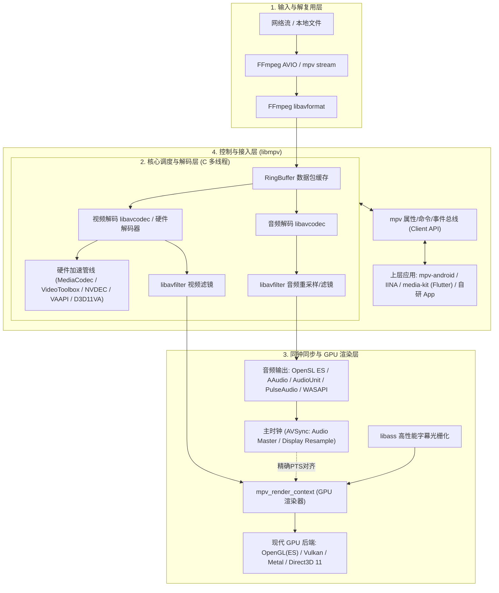

# mpv / libmpv 架构深度解析与实战指南

`mpv`（核心导出为 `libmpv`）是目前开源音视频领域公认的**最现代化、最高性能的 FFmpeg 播放内核**。它由早期 MPlayer 和 mplayer2 分支重构而来，彻底移除了陈旧的历史代码袱包，并将整个内部管线重塑为清晰的事件驱动与属性驱动模型。

在移动端与跨平台领域，由于 B站开源的 `ijkplayer` 长期停更、代码滞留在 FFmpeg 3.x/4.0 且缺失对现代硬件渲染（Vulkan/Metal）、新型编码格式（AV1）和 HDR/色调映射的支持，**`libmpv` 已经成为业内替代 ijkplayer 的事实工业级标准**。

---

## 一、mpv 核心架构设计

`mpv` 的设计哲学是：**底层核心高度依托 FFmpeg，中层高度抽象播放控制与时钟同步，顶层提供简洁强固的 C API，渲染端深度结合现代 GPU 硬件**。



### 1. 与 FFmpeg 的深度绑定
* **解复用与分流（Demuxer）**：完全基于 `libavformat`，但在其上增加了可动态扩容的环形内存缓冲区（Demuxer Cache），大幅提升网络断流与弱网对抗能力。
* **解码管线（Decoders）**：基于 `libavcodec` 最新版本（支持 FFmpeg 6.x / 7.x 的 `avcodec_send_packet` / `avcodec_receive_frame` 异步异步模型），摒弃了 ijkplayer 中仍在使用的陈旧废弃 API。
* **硬件解码（HW Acceleration）**：天然支持主流平台的现代硬解直通与内存零拷贝模式：
  * **Android**：MediaCodec Direct (Surface) 与 MediaCodec Copy
  * **iOS / macOS**：VideoToolbox
  * **Windows**：D3D11VA / DXVA2
  * **Linux**：VAAPI / NVDEC

### 2. 独步开源界的 GPU 渲染器（`vo_gpu` / `vo_gpu_next`）
与传统播放器（简单使用 OpenGL 贴图转换 YUV420P 到 RGB）不同，mpv 的渲染子系统具备桌面级/影视级精度：
* **高质量色调映射（Tone Mapping）**：内置 BT.2020 到 BT.709 色彩空间转换，支持 HDR10、Dolby Vision、HLG 的动态色调映射。
* **高级插值算法**：内置 Mitchell-Netravali、EWA Lanczos、Bicubic 等重采样算法。
* **GPU 渲染抽象**：通过 `mpv_render_context`，将渲染直接集成到调用宿主的 GL/Metal/Vulkan 纹理上下文，无需通过昂贵的 CPU 内存拷贝回传。

### 3. 字幕引擎（libass 集成）
mpv 对 ASS/SSA 复杂特效字幕与 SRT/VTT 文本字幕拥有行业最高标准的解析渲染能力，直接在 GPU 渲染管线内部完成字幕叠加，杜绝音视频卡顿与字体锯齿。

---

## 二、libmpv C API 核心交互模型

`libmpv` 将播放器所有的状态控制与数据查询统一抽象为极简的 **Client API**，主要由三大机制组成：

1. **属性机制（Properties）**：读写或监听播放器属性（如时长、位置、音量、缓冲百分比、音视频轨、画质设置）。
2. **命令机制（Commands）**：发送播放控制指令（如 `loadfile`, `seek`, `pause`, `playlist-next`）。
3. **事件循环机制（Events）**：异步通知上层宿主状态变更（如属性变化、文件加载完成、EOF、日志、渲染帧到达）。

### 核心 API 生命周期范例

```c
#include <mpv/client.h>
#include <mpv/render_gl.h>
#include <stdio.h>

int main() {
    // 1. 创建播放器实例
    mpv_handle *mpv = mpv_create();
    if (!mpv) return -1;

    // 2. 配置启动属性 (硬解、缓存等)
    mpv_set_option_string(mpv, "hwdec", "auto");            // 开启硬件解码
    mpv_set_option_string(mpv, "vo", "libmpv");             // 指定使用渲染上下文
    mpv_set_option_string(mpv, "demuxer-max-bytes", "32MiB");// 设置网络缓冲大小

    // 3. 初始化实例
    if (mpv_initialize(mpv) < 0) return -1;

    // 4. 监听关心的属性变化
    mpv_observe_property(mpv, 0, "time-pos", MPV_FORMAT_DOUBLE);
    mpv_observe_property(mpv, 0, "pause", MPV_FORMAT_FLAG);

    // 5. 加载媒体源
    const char *cmd[] = {"loadfile", "https://example.com/live/stream.m3u8", NULL};
    mpv_command(mpv, cmd);

    // 6. 事件驱动循环
    while (1) {
        mpv_event *event = mpv_wait_event(mpv, -1);
        if (event->event_id == MPV_EVENT_SHUTDOWN) break;

        if (event->event_id == MPV_EVENT_PROPERTY_CHANGE) {
            mpv_event_property *prop = (mpv_event_property *)event->data;
            if (strcmp(prop->name, "time-pos") == 0 && prop->format == MPV_FORMAT_DOUBLE) {
                printf("当前播放进度: %.2f 秒\n", *(double *)prop->data);
            }
        }
    }

    // 7. 销毁实例
    mpv_terminate_destroy(mpv);
    return 0;
}
```

---

## 三、mpv 对比 ijkplayer：为什么是全面升级？

| 核心维度 | ijkplayer (Bilibili) | mpv / libmpv | 差异分析与意义 |
| :--- | :--- | :--- | :--- |
| **维护状态** | 停滞多年（社区已处于废弃状态） | **极度活跃**（几乎每日更新） | ijkplayer 面临现代 OS/NDK 编译报错、安全漏洞无法修复等问题 |
| **FFmpeg 版本** | 锁死在 FFmpeg 3.x / 4.0 | **紧随主线**（FFmpeg 6.x / 7.x） | 支持现代格式（AV1, VVC/H.266）、最新协议（SRT, QUIC/HTTP3） |
| **API 模型** | 模拟 Android MediaPlayer 接口 | 统一事件/属性驱动（`libmpv`） | `libmpv` 架构解耦更彻底，扩展参数无须修改 C 底层源码重新编译 |
| **渲染管线** | OpenGL ES 2.0 基础纹理贴图 | **现代 GPU 管线**（GLES, Vulkan, Metal） | mpv 色彩保真度更高，耗电与显存利用率更低 |
| **HDR 与 色彩管理** | 不支持 / 颜色失真发灰 | **专业级 Tone Mapping**、ICC、HDR10 | 完美支持广色域和 10-bit / HDR 片源正常映射播放 |
| **多字幕特效 (ASS)** | 需外挂简陋魔改的 libass | **原生深度调优 libass**，GPU 直绘 | 字幕无排版锯齿、不卡顿、支持动态复杂特效动画 |
| **跨平台统一性** | 仅 Android、iOS（两套 JNI/OC 胶水） | **Android, iOS, macOS, Windows, Linux** | 真正实现“全端一套底层 C/C++ 核心管线” |

---

## 四、主流衍生开源生态与集成路径

### 1. `media-kit`：Flutter / Dart 全平台工业级播放器
* **开源组织与仓库**：
  * GitHub: [media-kit/media-kit](https://github.com/media-kit/media-kit)
  * 官网文档: [media-kit.dev](https://media-kit.dev)
  * 官方 Dart/Flutter 包: `package:media_kit`、`package:media_kit_video`
* **支持平台**：**Android、iOS、macOS、Windows、Linux、Web**（全端覆盖）。
* **核心架构与工作原理**：
  * **底层封装**：直接基于最新主线 **FFmpeg** 与 **`libmpv`** 预编译多平台 C 共享库。
  * **音视频管线**：使用 Dart FFI 高性能直接桥接 `libmpv` 的 C API，彻底跳过了原生平台缓慢的 MethodChannel。
  * **GPU 纹理渲染**：利用 `mpv_render_context` 将每一帧直接绘制到各操作系统的原生显存共享纹理上：
    * **Android**：SurfaceTexture / HardwareBuffer
    * **iOS / macOS**：Metal Texture (`CVPixelBuffer` / `IOSurface`)
    * **Windows**：Direct3D 11 (`ID3D11Texture2D`)
    * **Linux**：OpenGL / EGL
  * **官方模块拆分设计**：
    * `media_kit`：核心播放控制、状态属性流（Stream API）、音轨/字幕/倍速控制；
    * `media_kit_video`：UI 渲染组件（`Video` Widget），集成硬件加速与原生 Texture 桥接；
    * `media_kit_libs_***`：官方针对各平台预编译的动态链接库（免去开发者自行编译 FFmpeg/libmpv 的复杂繁琐流程）。
* **Flutter 快速上手示例**：
  ```yaml
  # pubspec.yaml
  dependencies:
    media_kit: ^1.1.10
    media_kit_video: ^1.2.4
    # 引入全平台预编译二进制动态库
    media_kit_libs_video: ^1.0.4
  ```
  ```dart
  import 'package:flutter/material.dart';
  import 'package:media_kit/media_kit.dart';
  import 'package:media_kit_video/media_kit_video.dart';

  void main() {
    WidgetsFlutterBinding.ensureInitialized();
    // 1. 初始化 native 绑定 (内部加载 libmpv 运行时)
    MediaKit.ensureInitialized();
    runApp(const MyApp());
  }

  class MyPlayerPage extends StatefulWidget {
    @override
    State<MyPlayerPage> createState() => _MyPlayerPageState();
  }

  class _MyPlayerPageState extends State<MyPlayerPage> {
    late final player = Player();
    late final controller = VideoController(player);

    @override
    void initState() {
      super.initState();
      // 打开视频 (支持本地文件、网络流 RTSP/RTMP/HLS 等)
      player.open(Media('https://example.com/live/stream.m3u8'));
    }

    @override
    void dispose() {
      player.dispose();
      super.dispose();
    }

    @override
    Widget build(BuildContext context) {
      return Scaffold(
        body: Center(
          // 2. 原生硬解 GPU 纹理直接渲染
          child: Video(controller: controller),
        ),
      );
    }
  }
  ```
* **为什么推荐它**：
  * 彻底解决了 Flutter 官方 `video_player` 插件在桌面端支持稀烂、格式支持少（无法播放 MKV/FLV/RMVB/特殊音频编码）的硬伤。
  * 官方维护了各端（甚至 Android/iOS）的自动构建 CI，直接提供了打磨好的预编译动态库，是目前不想折腾 C/C++ 交叉编译、又想拥有 FFmpeg+mpv 顶级解码渲染能力的最快落地途径。
### 2. `mpv-android`：原生 Android 替代 ijkplayer
* **定位**：`mpv` 针对 Android 的官方移植项目。
* **技术亮点**：
  * 提供了基于 CMake / Meson 的完整 Android NDK 交叉编译脚本。
  * 实现了 `MPVView` 原生组件，支持 SurfaceView / TextureView，支持软解与 MediaCodec 硬解自动降级机制。
  * 完全暴露 Kotlin/Java 包装的 `MPVLib` JNI 接口，可无痛平替旧版 ijkplayer。

### 3. `IINA`：macOS 端标杆播放器
* **定位**：macOS 平台用户量极高的开源播放器。
* **架构方案**：底层纯粹使用 `libmpv`，上层完全采用 Swift + Cocoa 原生渲染，完美证明了 `libmpv` 与现代 UI 框架解耦集成的强悍实力。

---

## 五、Android / 移动端移植与编译避坑指南

若需要在自研项目中基于 `libmpv` 编译出适合 Android/iOS 的 `.so` / `.framework`，常见注意事项如下：

1. **构建系统选择**：
   * mpv 主线已经全面迁移到 **Meson + Ninja** 构建系统，旧版本的 `./waf` 已废弃。
   * 交叉编译需要编写针对 Android NDK 的 `cross_file.txt`，声明 `ar`、`clang`、`pkg-config` 路径。
2. **依赖库裁剪（减小体积包）**：
   * 默认 mpv 功能全开会引入大量的依赖库（libplacebo、libass、uchardet、fribidi 等）。
   * **裁剪策略**：
     * 如果不需要高级特效字幕，可裁剪掉 `libass`；
     * 如果只需要特定音视频协议，在编译底层 FFmpeg 时加上 `--disable-everything --enable-decoder=h264,hevc,aac...`，可将整个产物 `.so` 体积控制在 10MB 左右。
3. **渲染上下文选择**：
   * 移动端优先选用 `render_gl`（绑定 OpenGL ES 3.0 上下文）或 `render_vulkan`。
   * Android 上推荐直接使用 `ANativeWindow` 将 OpenGL/Vulkan 绘制关联到 `SurfaceView`，避免 `TextureView` 带来的二次显存复制开销。

---

## 六、总结

* **对于音视频学习者**：`ffplay.c` 是理解 AVSync 和数据队列的基础；而 `mpv` 则是**从教学示例到工业级商用软件的最佳桥梁**。
* **对于企业和开发者选型**：在移动端或多端项目中，应当停止在停止维护的 `ijkplayer` 上做无意义修补；无论是直接集成 `media-kit` 还是基于 `libmpv` 定制自研核心，`mpv` 生态都是目前面向未来、架构最健康的 FFmpeg 播放引擎方案。
